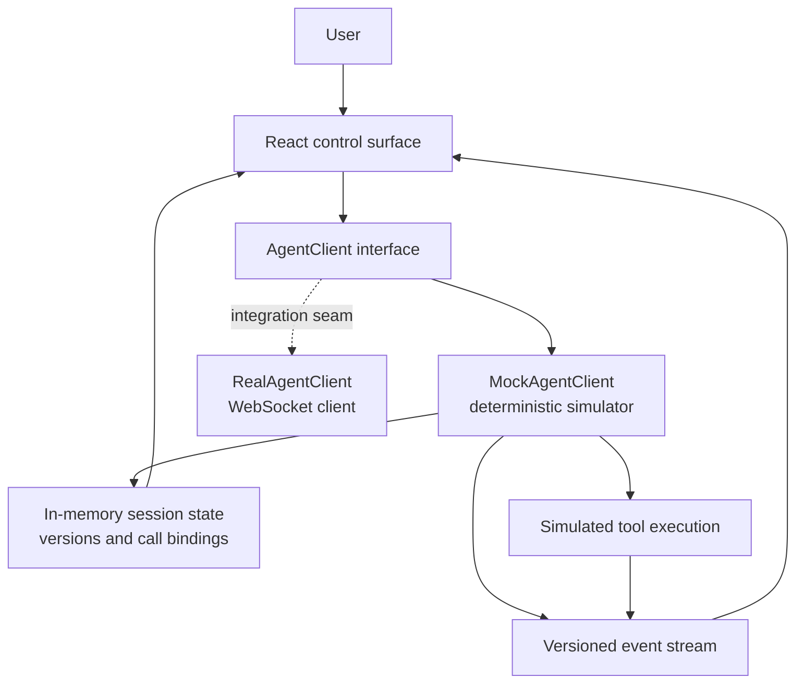

# AURA

**Intelligence that adapts to your latest intent.**

AURA is an AI assistant designed to adapt when the user's intent changes. It coordinates reasoning, tool execution, cancellation, state versioning, and verification so that outdated operations cannot silently override newer decisions.

AURA treats an interruption as a first-class execution event. Existing work may continue to finish in the background, but a result that no longer matches the latest authoritative intent is rejected rather than rendered.

## Project Links

- **Website:** [AURA Live Website](https://interruptible-real-time-agent.vercel.app/)
- **Product demo:** [Watch the AURA demo](https://drive.google.com/drive/folders/1Ennxgx2lOPFOWgUtt2lR1oPX80RuxKdR?usp=drive_link)
- **GitHub:** [udbhavshukla/Interruptible-RealTime-Agent](https://github.com/udbhavshukla/Interruptible-RealTime-Agent)

## Implementation status

The repository contains a runnable **React + TypeScript frontend** and the **Python backend runtime** that drives it. The frontend ships a deterministic in-browser execution simulator (used for the offline demo and tests), while the backend provides the real per-session runtime: a single-writer Coordinator, bounded mailbox, task supervision, cooperative cancellation, the Acceptance Gate (stale-result rejection), a WebSocket server, and an optional model-provider layer.

Both the frontend (`npm run build`) and the backend (`python -m pytest tests`) build and pass in CI. Run `python -m aura.runtime.websocket_server` to start the WebSocket server and `npm run dev` in `frontend/` to connect to it. All tool results, metrics, sessions, and multimodal outputs are **simulated** unless a real model provider is configured; live provider calls are still unverified because no credentials are available in this environment.

See [Key features and status](#key-features-and-status) for a precise breakdown.

## Product vision and core principles

AURA's goal is an assistant that remains correct while a conversation is moving. Users change their minds, correct details, and redirect tasks while work is already in progress. AURA is designed around that behavior rather than treating it as an edge case.

### Latest Intent Wins

The newest user correction becomes authoritative. Corrections are localized to the affected state slots, and every real change advances a monotonic state version.

### Perception Proposes, Verification Commits

Audio and image perception produce structured proposals with confidence scores. Unverified perception does not become trusted state. Low-confidence results require clarification, and conflicts are surfaced rather than silently resolved.

### State is versioned

Every tool call is bound to the state version it was planned against. Results from obsolete versions are rejected as stale, as are unknown or invalidated calls.

### Cancellation has semantics

Cancellation is cooperative and truthful. It can prevent an effect before a commit boundary. After commitment, AURA reports the true status and reconciles through compensating actions instead of claiming that an undo occurred.

### Side effects are idempotent

State-changing operations are designed to carry idempotency keys scoped to a session and tool, so retries and duplicate deliveries do not execute the same effect twice.

### Intended application areas

The same execution model applies to travel and booking changes, in-car route redirection, support workflows, diagnostics with live image or audio input, and hands-free accessibility scenarios. These are product directions; the runnable prototype covers the simulated flight-search flow end to end.

## Key features and status

| Capability | Current status | Where it lives |
|---|---|---|
| Fast-path acknowledgement | **Works in simulator and backend** | `frontend/src/services/MockAgentClient.ts`, `aura/runtime/coordinator.py` |
| Asynchronous tool execution | **Backend runtime** (supervised async tasks) | `aura/runtime/supervisor.py` |
| Interruption detection and cancellation | **Backend runtime** (cooperative, tombstone-then-signal) | `aura/runtime/cancellation.py` |
| Versioned session state and re-planning | **Backend runtime** (monotonic versions) | `aura/runtime/coordinator.py` |
| Stale-result rejection | **Backend runtime** (Acceptance Gate) | `aura/runtime/acceptance.py` |
| Tool registry and manifest schema | **Frontend catalog + backend tool contract** | `frontend/src/data/catalog.ts`, `agent/` |
| Tool lifecycle, idempotency, commit boundaries | **In simulator, manifests, and UI** | `catalog.ts`, Tools page |
| Multimodal transcription and grounding | **Deterministic simulation** | `MockAgentClient.ts`, Multimodal page |
| Sessions, activity, analytics, system health | **UI with seeded or simulated data** | `frontend/src/pages/` |
| Real WebSocket transport | **Implemented** (`/ws`), with mock fallback in the UI | `aura/runtime/websocket_server.py`, `RealAgentClient.ts` |
| Model-provider integration | **Implemented** (OpenAI-compatible + mock); live vendor calls unverified | `aura/llm/`, `aura/assistant/` |
| Automated tests and CI | **409 tests; GitHub Actions (backend matrix + frontend build)** | `tests/`, `.github/workflows/ci.yml` |
| Persistent storage, authentication, deployment automation | **Not implemented** | — |

Simulated values are labeled as mock data in the interface. They are not benchmarks or production measurements.

## How interruptible execution works

AURA separates the immediate response path from long-running work:

```
USER
 ↓
FAST ACK              immediate acknowledgement and interruption handling
 ↓
ASYNC EXECUTION       tools run without blocking the conversation
 ↓
INTERRUPTION          a new intent arrives while work is in flight
 ↓
CANCEL / INVALIDATE   obsolete work is cancelled and its version binding revoked
 ↓
STATE UPDATE          the corrected slot changes; the state version advances
 ↓
RE-PLAN               a new call is planned against the new version
 ↓
VERIFY                results and perceptions are checked before commit
 ↓
CURRENT RESULT        only output matching the latest intent is rendered
```

### Canonical scenario

1. The user asks: "Find a flight from Bangalore to Delhi."
2. AURA acknowledges immediately and starts a simulated search as `call_001`, bound to the current state version.
3. The user interrupts: "Actually Mumbai, not Delhi."
4. AURA cancels `call_001`, updates the destination, advances the state version, and re-plans as `call_002`.
5. The late `call_001` result arrives, is bound to the old version, and is rejected as stale.
6. The `call_002` result arrives, matches the current version, and is accepted.

Final state: `origin = Bangalore`, `destination = Mumbai`. This demonstrates the core guarantee: old work may physically complete, but it cannot overwrite the latest authoritative state.

Open `/agent?demo=1` in the running frontend to watch this sequence, or use the interrupt control to provide a correction manually.

## System architecture



The frontend renders authoritative events and does not invent versions, lifecycle transitions, or staleness decisions. The event vocabulary and payload shapes are defined in `frontend/src/types.ts`.

The intended production architecture preserves the same separation:

- **Fast Path** handles acknowledgement, interruption detection, and immediate feedback.
- **Coordination** owns ordering, state versions, cancellation, and re-planning.
- **Slow Path** executes asynchronous tools and multimodal grounding.
- **Verification** gates results and perceptions before they are committed.

The coordination layer, state manager, tool runtime, and verification services are implemented in the `aura/runtime/` package and are exercised by the backend test suite. The frontend's `RealAgentClient` connects to the server's `/ws` endpoint; when the backend is unreachable, the UI falls back to the deterministic simulator and says so in a toast.

## Technology stack

| Layer | Technology | Verified from |
|---|---|---|
| Frontend | React 18, TypeScript 5, Vite 5, React Router 6 | `frontend/package.json` |
| UI | Custom CSS design system, hand-rolled SVG charts, no UI framework | `frontend/src/styles/`, `frontend/src/components/` |
| Execution simulator | Deterministic timers and versioned event emission | `frontend/src/services/MockAgentClient.ts` |
| Backend runtime | Python 3 (asyncio), no framework in the coordination core | `aura/runtime/`, `src/state/`, `src/tools/` |
| WebSocket server | FastAPI + Uvicorn | `aura/runtime/websocket_server.py` |
| Model provider | Standard-library OpenAI-compatible client + in-process mock | `aura/llm/`, `aura/assistant/` |
| Backend seam | `AgentClient` interface and WebSocket client | `frontend/src/services/` |
| Build | `tsc --noEmit && vite build` | `frontend/package.json` |

## Screenshots and demo

- **Live product:** https://interruptible-real-time-agent.vercel.app/
- **Product demo video:** https://drive.google.com/drive/folders/1Ennxgx2lOPFOWgUtt2lR1oPX80RuxKdR?usp=drive_link

The repository does not currently include screenshots. The Live Agent route at `/agent?demo=1` is the quickest way to see the interruption flow.

## Installation and local setup

Requirements: Node.js 20+ with npm (frontend) and Python 3.11–3.12 (backend). The frontend was verified with the dependencies pinned in `frontend/package-lock.json`; backend dependencies are in `requirements.txt` / `requirements-dev.txt`.

```bash
git clone https://github.com/udbhavshukla/Interruptible-RealTime-Agent.git
cd Interruptible-RealTime-Agent/frontend
npm install
```

## Environment variable configuration

No environment variables are required: the backend defaults to fully offline, deterministic answers. A template is provided in [`.env.example`](.env.example). The assistant model provider is opt-in via `AURA_LLM_*` variables (`AURA_LLM_PROVIDER=none|mock|openai`, `AURA_LLM_BASE_URL`, `AURA_LLM_MODEL`, `AURA_LLM_TIMEOUT_S`, `AURA_LLM_API_KEY`); configuration is read **server-side only** and keys are never sent to the browser or logged.

The frontend reads its WebSocket URL from the environment and otherwise defaults to `ws://localhost:8000/ws`.

Do not add credentials or provider keys to the repository. Keep secrets in untracked environment files or a secret manager.

## Running the frontend and backend

### Frontend

```bash
cd frontend
npm install
npm run dev
```

Open http://localhost:5173/. For the scripted interruption scenario, open http://localhost:5173/agent?demo=1.

To serve a production build locally:

```bash
npm run build
npm run preview
```

### Backend

```bash
python -m pip install -r requirements-dev.txt
python -m aura.runtime.websocket_server    # serves ws://localhost:8000/ws
```

With the frontend running on http://localhost:5173/ and the backend on :8000,
the UI's `RealAgentClient` connects automatically (override the URL with
`VITE_WS_URL`). Set `AURA_LLM_PROVIDER` (see `.env.example`) to use a model
provider; the default `none` keeps answers deterministic and offline.

(The `run_local.py` / `harness/` files are the evaluation kit's scenario
runner — `python run_local.py --all` — and are unrelated to serving the app.)

## Running automated tests

```bash
python -m pip install -r requirements-dev.txt
python -m pytest tests -q                 # backend: 409 tests
cd frontend && npm run build              # type-check + production bundle
```

The same two commands run in CI (`.github/workflows/ci.yml`) on every push and
pull request. There is no lint or format script configured in `package.json`.

## Model-provider configuration

A model-provider layer lives in [`aura/llm/`](aura/llm/) and [`aura/assistant/`](aura/assistant/). It speaks the OpenAI-compatible `/chat/completions` protocol using only the standard library (`urllib` in a worker thread), so no vendor SDK is required, and it also ships an in-process `mock` provider for tests.

- **Default (`none`)**: answers are the runtime's deterministic text; no network call is made.
- **`mock`**: the in-process provider, used by tests and offline demos.
- **`openai`** (any compatible endpoint): the enabled responder phrases the gate-accepted result. If the provider is unreachable, times out, or returns nothing usable, the responder degrades to the deterministic answer rather than failing the turn.

Keys are read from the server environment only, never sent to the browser, and `ProviderConfig.redacted()` keeps them out of logs. Every server-side call has a timeout. The provider path is verified with a local fake endpoint and the mock provider; a live vendor conversation is **not** verified here because no credentials are available in this environment.

## Available tools and integrations

The frontend ships six tool manifests. They describe intended contracts and power the Tools page and dry-run mock:

| Tool | Kind | Semantics |
|---|---|---|
| `flight_search` | Read only | Searches inventory for origin, destination, and date. No side effects. |
| `manual_lookup` | Read only | Retrieves trusted device facts from manuals for verification. |
| `barcode_lookup` | Read only | Resolves a scanned barcode to a device model. |
| `reserve` | Preparatory | Soft-holds an option and remains reversible before commit. |
| `booking` | State modifying | Commits a reservation at a commit boundary; idempotency key required. |
| `cancel_booking` | Compensating | Reconciles an already-committed booking; not cancellable itself. |

**No real external integration is connected.** Flight results, device data, reservations, and bookings are generated by the deterministic simulator or are dry-run UI responses. No payment, inventory, or booking provider is contacted.

## Security and privacy considerations

- The WebSocket server keeps session state **in memory only**; it has no database and writes nothing to disk.
- There is **no authentication or authorization**: `/ws` accepts any connection and a client chooses its own `session_id`. Do not expose this server to untrusted networks as-is.
- No telemetry or analytics service is integrated.
- Theme preference is the only value persisted, through browser `localStorage`.
- Uploaded images are read locally for preview and are not transmitted by the simulator.
- No secrets or provider credentials are stored in the repository. Model keys are read server-side from the environment and redacted in logs.
- The WebSocket transport uses an unencrypted local URL by default and must not be treated as production-ready; terminate TLS in front of it for any remote use.

The full findings and severity ratings are in [`docs/SECURITY_AUDIT.md`](docs/SECURITY_AUDIT.md). Before connecting real users, tools, or model providers, add authenticated transport, session ownership checks, message-size and rate limits, secret management, audit logging, data-retention rules, and explicit user consent for audio and image processing.

## Current limitations

- All tool results, sessions, analytics, and system-health values are simulated or seeded. The served flight search is deterministic demo data.
- The model provider is implemented but a **live vendor call is unverified** here (no credentials). The offline and mock paths are tested end to end.
- State is in-memory and session-scoped; there is no persistence or distributed coordination.
- There is no authentication, database, or multi-tenant isolation.
- Token-level streaming exists in the provider API but the WebSocket transport currently sends the completed answer in one `FINAL_RESPONSE` frame.
- There is no Dockerfile or deployment automation. CI covers tests and the frontend build.
- The public website may lag behind the current local build until it is redeployed; the previously deployed bundle predates the current source and its deep routes returned 404 (see `docs/REPOSITORY_AUDIT.md`).

## Development roadmap

The backend runtime, WebSocket transport, and provider layer are implemented. The ordered plan for what remains — including verification against a live provider, streaming deltas, persistence, and production hardening — is in [`docs/PROJECT_ROADMAP.md`](docs/PROJECT_ROADMAP.md). In brief:

1. **Verify a live provider** — run the OpenAI-compatible path against a real endpoint, record latency/failure behaviour, and label model output in the UI.
2. **Stream answers** — emit provider deltas over `/ws` and render them incrementally.
3. **Integrate real tools** — start with read-only providers, then preparatory and commit-boundary operations with idempotency and compensation.
4. **Persist sessions** — durable state, replay, and audit history.
5. **Harden for production** — authentication, session ownership, TLS, rate limits, secret management, observability, and deployment automation.
6. **Deploy the current build** — redeploy the site with SPA rewrites so deep routes resolve and the stale bundle is replaced.
7. **Expand verification** — stronger multimodal confidence handling, conflict detection, and clarification flows.

## Contribution and development guidelines

- Keep the protocol contract intact: every tool call and result should remain bound to `session_id`, `call_id`, and `state_version`.
- Preserve the distinction between perception proposals and committed state.
- Do not replace simulated behavior with unlabeled fixtures. Mark mock data clearly in the interface.
- Run `python -m pytest tests -q` and `cd frontend && npm run build` before proposing a change; strict TypeScript errors fail the build.
- Add a test with every runtime, protocol, or provider change. The suites live in `tests/` (runtime, state, tools, protocol, llm, assistant); use `unittest.IsolatedAsyncioTestCase` or `asyncio.run` for async tests.
- Keep secrets and provider credentials out of version control.
- Update this README when behavior, setup, or status changes.

## License

No license file is currently included in this repository. Add an explicit license before distributing or accepting external contributions.

## Project identity

Background on the independent product identity and the documentation cleanup is recorded in [`docs/PROJECT_IDENTITY.md`](docs/PROJECT_IDENTITY.md).
